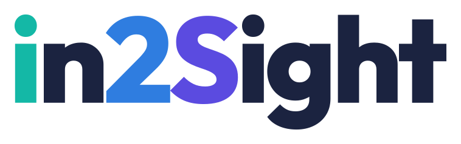
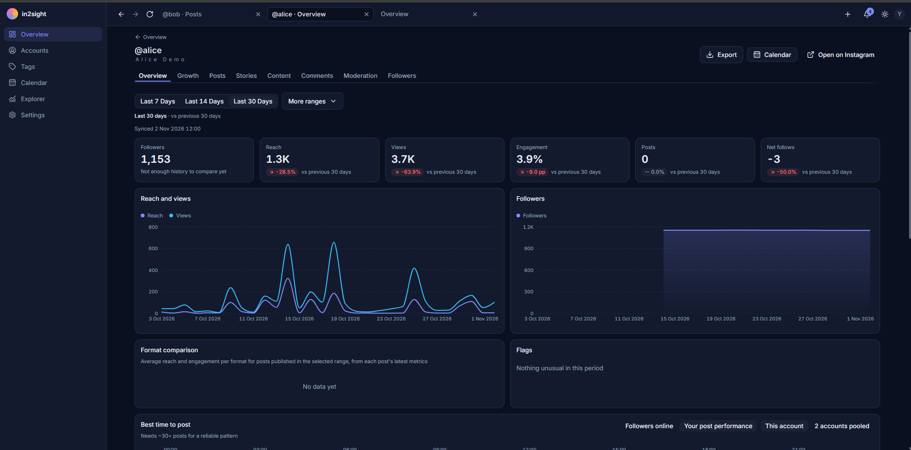
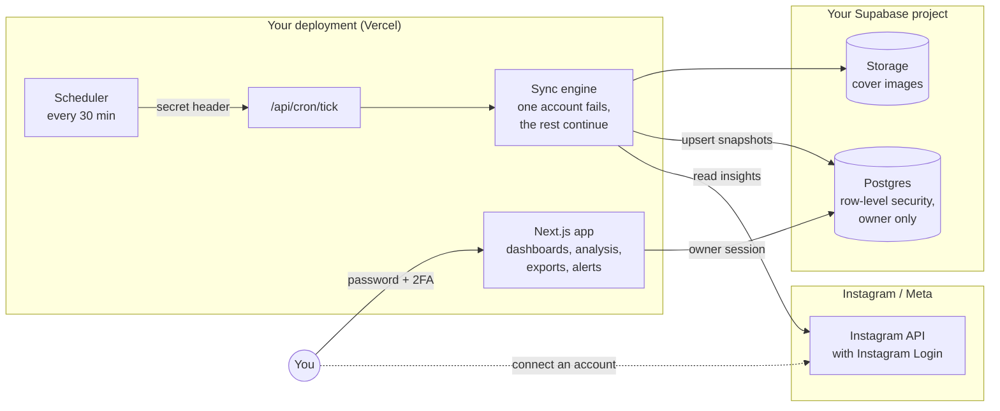

<div align="center">

<h1>
  <picture>
    <source media="(prefers-color-scheme: dark)" srcset="docs/brand/wordmark-on-dark.svg">
    
  </picture>
</h1>

### Open-source Instagram analytics that remember

**Connect your accounts. Record the trend. Understand what works. Decide what to post next.**<br>
Your data stays in your own database. Next: an optional AI strategist, with you in control.

[](https://github.com/YsYeoh/in2sight/actions/workflows/ci.yml)
[](LICENSE)


[**User manual**](docs/MANUAL.md) · [How it works](#-how-it-works) · [Security](#-security-and-compliance) · [Roadmap](#-roadmap) · [Contributing](#-contributing)

<br>



<sub>The account overview (dark theme), running on real data, with the account names replaced. Tabs: Overview, Growth, Posts, Stories, Content, Comments, Moderation, Followers.</sub>

</div>

---

## What it is

in2Sight is a self-hosted dashboard that pulls your Instagram insights through Meta's official API and **keeps them**. Instagram's own Insights forgets: account-level numbers reach back only about 90 days and Stories vanish after 24 hours. in2Sight records continuously (Stories every 30 minutes, everything else daily) into a database you own, so the history, and what you can learn from it, grows every day.

**Who it is for:** creators and small brands who run one or more Instagram accounts and want to answer "what is working, what changed, and what should I post next" without screenshots and spreadsheets. **Where it stands:** a working prototype used on two real accounts, one owner per deployment, built openly. See [Project status](#-project-status) for the honest list of what is and is not verified.

---

## ✨ What works today

<table>
<tr>
<td width="33%" valign="top">

### 🔌 Connect and record
Connect Instagram Creator or Business accounts through Instagram's own login. A scheduled sync stores follower and reach history, every post's metrics over time, Story metrics while a Story is live, audience demographics and covers. A new account fills **newest-first**: useful within minutes.

One failing account never stops the others. Tokens renew themselves.

</td>
<td width="33%" valign="top">

### 📈 Trends and analysis
A shared time range with compare-to-previous, a **Growth** tab with a stated-method projection and "why did this change?", a **Content lab** (leaderboards, formats and times, hashtags, cadence), a per-post scorecard against your own history, tags, a calendar and a free-form **Explorer**.

Every analysis states its sample size and confidence. A missing number is never shown as zero.

</td>
<td width="33%" valign="top">

### 💬 Decide and follow through
Comments: unanswered questions, top fans, topics. Optional moderation (reply, hide, delete, banned-word rules), always confirmed and logged. Alerts and Web Push (installable PWA). Excel and PDF reports.

**Export or delete everything** from Settings. English and 简体中文, light and dark themes, phone to desktop.

</td>
</tr>
</table>

---

## 🧭 How it works

You run your own copy. A scheduler wakes the sync every 30 minutes; the sync reads Instagram through Meta's official API and writes to **your** database; the app reads it back under row-level security.



**Stack:** Next.js 16 (App Router, TypeScript strict) on Vercel · Supabase (Postgres, Auth, Storage) · Tailwind + shadcn/Radix · Recharts · next-intl · Vitest. Small on purpose: plain `fetch` for the Meta API, analysis as pure unit-tested functions in [`lib/analysis/`](lib/analysis/), every database change a SQL migration in [`supabase/migrations/`](supabase/migrations/).

---

## 🔒 Security and compliance

in2Sight handles Instagram tokens and other people's names and comments, so security is a feature, not an afterthought. The full write-up is **[SECURITY.md](SECURITY.md)**; the summary:

| Layer | What is in place |
|---|---|
| **Access** | One owner per deployment · sign-ups off · TOTP two-factor enforced **by the database** (a password-only session reads nothing) · exact public-route allow-list · every page, route and action re-checks the owner |
| **Data** | Row-level security on every table · private cover storage · export and delete-all with password re-check and typed confirmation · third-party data excluded from exports unless you opt in |
| **Secrets** | Instagram tokens readable only by the server's service role · no secrets in the browser · no secret logging · cron and Meta callbacks authenticated (constant-time secret, HMAC-signed requests, OAuth `state`) |
| **Writes to Instagram** | Confirmed, logged, reversible where possible · auto-hide off by default |
| **Verification** | 3,000+ automated tests including guard tests for the rules above (run on every push by CI) · AI-assisted security review of each sensitive feature (no Critical findings open) · a live-verification runbook per feature |

**Compliance posture, honestly:**

| | |
|---|---|
| ✅ Designed to align with | Meta Platform Terms (official API only, signed deauthorize and deletion callbacks) · GDPR-style principles (self-hosted, minimisation, access control, export, erasure) |
| ⚠️ Not yet | Independent security audit · penetration test · complete live verification of every feature |
| ❌ Not claimed | SOC 2, ISO 27001 or any certification. If you host it, **you** are the data controller and responsible for your own compliance (privacy notice, lawful basis, processor terms) |

**Known limits** (all in SECURITY.md): enrol 2FA before enabling password-reset email; some password rules are app-level, not a Supabase boundary; signed-out devices stay valid up to an hour; no recovery codes; only a minimal Content Security Policy. **Found a vulnerability?** Use the repository's **Security → Report a vulnerability** (private), not a public issue.

---

## 🚀 Run it yourself

Everything uses free plans: **Vercel**, **Supabase**, **Meta for Developers**, **cron-job.org**. Allow about an hour.

```bash
git clone https://github.com/<you>/in2sight.git && cd in2sight
npm install
cp .env.example .env.local      # fill it in; see the manual
npm run check:env               # checks names and formats, never prints a value
npx supabase link --project-ref <ref> && npx supabase db push   # create the tables
npm run dev                     # http://localhost:3000
```

➡️ **[Read the full user manual](docs/MANUAL.md)**: Supabase and Meta setup, environment variables, deploying to Vercel, the scheduler, first sign-in and 2FA, a tour of every screen, updating, backups, troubleshooting.

A Meta app left in Development mode works for accounts you add yourself, with no App Review. That is why today's version is a personal tool. You can work on most of the code (analysis, components, tests) without any account: `npm test` needs no secrets or network.

---

## 📊 Project status

| Area | State |
|---|---|
| Connect, sync, dashboards, tags, alerts, PWA, exports | ✅ Built and used against two real accounts |
| Growth, Followers, Comments, Moderation, Settings, Security, Data and privacy, Content lab | 🔎 Code complete and tested; live walkthroughs pending (each has a runbook in [`docs/`](docs/)) |
| Writing to Instagram (reply, hide, delete, auto-hide) | ⚠️ Implemented, **never yet exercised against live Instagram**; auto-hide is off by default |
| Automated checks | ✅ `npm run check` (lint, typecheck, tests, build), run by CI on every push |
| Independent security review | ❌ Not done |
| AI strategist and Ads plugin | ❌ Not built (see roadmap) |
| Multiple users / hosted service | ❌ Not built; single-owner by design today |

---

## 🔭 Roadmap

Detailed plans live in [`docs/superpowers/plans/`](docs/superpowers/plans/). A phase is "done" only when its live checks pass.

| Phase | Goal | Status |
|---|---|---|
| **0. Foundation** | auth with 2FA, Instagram connect, sync engine, dashboards, alerts, PWA, exports | ✅ built |
| **1. Analytics suite** | Time Scope, Explorer, Post Lab, Growth, Followers, Comments, Moderation, Settings, security, data and privacy, **Content lab** | ✅ code complete · 🔎 live walkthroughs pending |
| **2. Verify and harden** | walk every runbook with real data, record real API fixtures, independent security review | 🚧 now |
| **3. Weekly planning tools** | Insights feed and "Today" · auto-tagging · goals and digest · smart alerts · planner board | 📐 planned in detail |
| **4. AI-ready platform** | structured findings as a data contract, a read-only tool interface (MCP / REST), a proposals queue, usage and cost controls | 🔭 planned |
| **5. Content understanding** | vision for images and video, speech-to-text, caption NLP, content features linked to performance | 🔭 planned |
| **6. AI strategist** | monitor loop, LLM reasoning, decision model, experiments, weekly strategy with evidence; hosted-model or self-hosted-agent | 🔭 planned |
| **7. Ads plugin** | boost proven posts with budget caps and approval; Meta marketing-API review | 🔭 later |
| **8. Open to everyone** | multi-user workspaces, Meta App Review, one-click self-host, hosted option, docs and community | 🔭 proposed, needs design |

**The direction:** an always-on AI that watches your traffic, understands what your content contains (vision, voice and text), and proposes what to post next, **with you approving everything**, on your own data and your own model key or self-hosted agent. None of it is built yet. The goal, the architecture, the principles and the guardrails are in **[docs/AI_BRAIN.md](docs/AI_BRAIN.md)**.

**What support would unlock:** phases 4 to 6 (the largest body of new work: vision and speech pipelines, an agent interface, an evaluation harness so recommendations are tested rather than trusted, cost controls); phase 8 (workspaces, Meta App Review, an independent security audit, a public privacy policy); and phase 2, the cheapest and most important step before either.

---

## 📚 Documentation

- **Start here:** [User manual](docs/MANUAL.md) · [Security and privacy](SECURITY.md) · [AI direction](docs/AI_BRAIN.md) · [Brand kit](docs/brand/README.md) · [Design spec](docs/SPEC.md) · [Progress](docs/TODO.md) and [handover](docs/PROGRESS.md)
- **Step-by-step setup:** [Supabase](docs/SETUP_SUPABASE.md) · [Meta / Instagram](docs/META_SETUP.md) · [Scheduler](docs/RUNBOOK_SYNC.md)
- **Building on it:** [UI rules](docs/UI_STANDARDS.md) · [visual reference](docs/mockups/README.md) · one runbook per feature in `docs/RUNBOOK_*.md`

## 🤝 Contributing

Issues, ideas and pull requests are welcome. Start with **[CONTRIBUTING.md](CONTRIBUTING.md)**: how to run the tests without any account, the rules that most often fail a review, a list of small good first tasks, and the pull request checklist. Be kind: [CODE_OF_CONDUCT.md](CODE_OF_CONDUCT.md). Please never post access tokens, `.env` contents or real follower or commenter data in issues. AI-assisted contributions are welcome if you say so and have tested them.

## 🙌 Credits

Designed and directed by **Yong Sen**, and built together with **[Claude Code](https://claude.com/claude-code)** (Anthropic). The workflow leans on Claude Code skills: **superpowers** (brainstorming, written plans, test-driven development, code review, verification before "done") and **ponytail** (the smallest thing that works, no speculative abstractions). Most code was written by AI agents working from reviewed plans, then checked by automated tests and AI-assisted review; the owner decides what is built and what ships.

## 📄 License

[MIT](LICENSE). Use it, change it, host it yourself.

<sub>in2Sight is an independent project. It is not affiliated with, endorsed by, or sponsored by Meta or Instagram. Instagram is a trademark of Meta Platforms, Inc.</sub>
