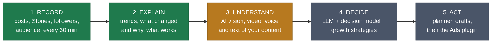
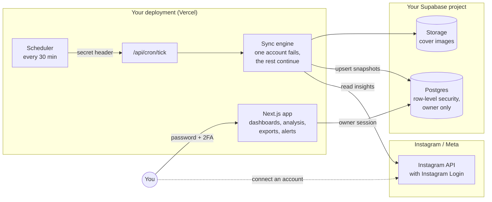
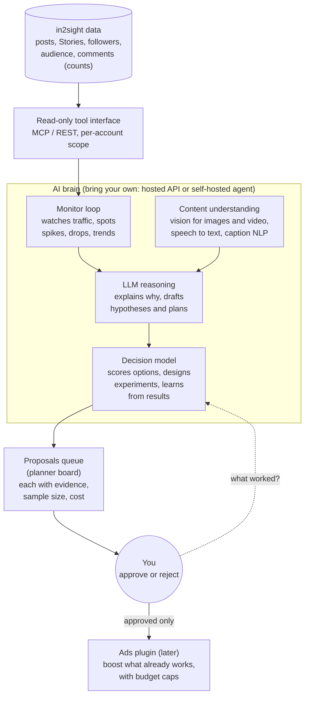

<div align="center">

# in2sight

### From Instagram analytics to an AI growth brain for your IP

**Record everything. Understand why it works. Let an AI strategist help you grow, with you holding the controls.**

[](LICENSE)


[**User manual**](docs/MANUAL.md) · [Vision](#-the-vision) · [How it works](#-how-it-works) · [Roadmap](#-roadmap) · [Project status](#-project-status)

<br>


<sub>The account overview (dark theme), running on real data. Tabs: Overview, Growth, Posts, Stories, Content, Comments, Moderation, Followers.</sub>

</div>

---

## 🎯 The vision

> **Give every creator and small brand the analyst, the strategist and the media buyer they cannot afford: an always-on AI that watches the traffic of your IP, understands what your content actually contains, and tells you (and, with your approval, does) what grows your audience. You keep the data and the final say.**

"Your IP" means your creator brand, channel, character or catalogue: the thing you are building an audience around.

Today's tools show you charts and leave the thinking to you. in2sight is being built in five stages, and **the first two already work**:



<sub>🟢 built (stage 2 is rule-based today) · 🟠 designed next · ⚫ planned</sub>

**Why a brain and not just a dashboard?** A number like "reach fell 28%" starts a question, it does not answer it. The answer sits in the content itself: the hook in the first second of a Reel, the face or product in the cover, what you said, the caption, the hour you posted, who is watching. A system that can *see, hear and read* your posts, remember what worked, and test new ideas can answer that question every day, which no person with a spreadsheet will.

**Principles that do not change as the AI grows**
- **You own the data.** It lives in your own database, on your own deployment. Self-hosted first.
- **Human in the loop.** The AI proposes; you approve. Nothing is posted, replied or spent without a click. Every action is logged and reversible where Instagram allows it.
- **Show the evidence.** Every claim states its sample size and confidence. "Not enough data" is an answer.
- **Bring your own brain.** Use a hosted model through your own API key (Claude, Codex and others) or a self-hosted agent runtime you control. No lock-in.
- **Private by default.** Your own content only. Other people's data (commenter names, follower lists) is never sent to a model unless you opt in.
- **Open source (MIT).** Auditable by the people whose accounts it touches.

---

## ✨ What works today

<table>
<tr>
<td width="33%" valign="top">

### 🔌 Connect and record
Connect Instagram Creator or Business accounts through Instagram's own login. A scheduled sync stores follower and reach history, every post's metrics over time, Story metrics while a Story is live, audience demographics and covers. A new account fills **newest-first**: useful within minutes.

One failing account never stops the others. Tokens renew themselves.

</td>
<td width="33%" valign="top">

### 📈 Trends and analysis
A shared time range with compare-to-previous, a **Growth** tab with a stated-method projection and "why did this change?", a **Content lab** (leaderboards, formats and times, hashtags, cadence), a per-post scorecard against your own history, tags, a calendar and a free-form **Explorer**.

Every analysis states its sample size and confidence. A missing number is never shown as zero.

</td>
<td width="33%" valign="top">

### 💬 Decide and follow through
Comments: unanswered questions, top fans, topics. Optional moderation (reply, hide, delete, banned-word rules), always confirmed and logged. Alerts and Web Push (installable PWA). Excel and PDF reports.

**Export or delete everything** from Settings. English and 简体中文, light and dark themes, phone to desktop.

</td>
</tr>
</table>

---

## 🧭 How it works

You run your own copy. A scheduler wakes the sync every 30 minutes; the sync reads Instagram through Meta's official API and writes to **your** database; the app reads it back under row-level security.



What makes it safe to point at real accounts:

| | |
|---|---|
| 🔐 **Owner-only** | Row-level security on every table; password plus TOTP two-factor; sign-ups off. Once 2FA is on, the database itself refuses a password-only session. |
| 🗝️ **Tokens stay server-side** | Instagram tokens sit in a table only the server's service role can read. Never in the browser, never logged. |
| ✅ **Official API only** | Instagram API with Instagram Login. No scraping, no passwords collected. |
| 🛑 **Fails closed** | The sync endpoint refuses requests without its secret; delete-all needs your password and a typed word; writes to Instagram are confirmed, logged and reversible where possible. |
| 🧪 **Tested** | 309 test files, about 3,100 tests, plus guard tests that fail the build if a log line or route could expose a secret or third-party data. |

Full detail, limits and a hardening checklist: **[Security and compliance](#-security-and-compliance)** and [SECURITY.md](SECURITY.md).

**Stack:** Next.js 16 (App Router, TypeScript strict) on Vercel · Supabase (Postgres, Auth, Storage) · Tailwind + shadcn/Radix · Recharts · next-intl · Vitest. Small on purpose: plain `fetch` for the Meta API, analysis as pure unit-tested functions in [`lib/analysis/`](lib/analysis/), every database change a SQL migration in [`supabase/migrations/`](supabase/migrations/).

---

## 🛡️ Security and compliance

in2sight handles Instagram tokens and other people's names and comments, so security is a feature, not an afterthought. The full write-up is **[SECURITY.md](SECURITY.md)**; the summary:

| Layer | What is in place |
|---|---|
| **Access** | One owner per deployment · sign-ups off · TOTP two-factor enforced **by the database** (a password-only session reads nothing) · exact public-route allow-list · every page, route and action re-checks the owner |
| **Data** | Row-level security on every table · private cover storage · export and delete-all with password re-check and typed confirmation · third-party data excluded from exports unless you opt in |
| **Secrets** | Instagram tokens readable only by the server's service role · no secrets in the browser · no secret logging · cron and Meta callbacks authenticated (constant-time secret, HMAC-signed requests, OAuth `state`) |
| **Writes to Instagram** | Confirmed, logged, reversible where possible · auto-hide off by default |
| **Verification** | About 3,100 tests including guard tests for the rules above · AI-assisted security review of each sensitive feature (no Critical findings open) · a live-verification runbook per feature |

**Compliance posture, honestly:**

| | |
|---|---|
| ✅ Designed to align with | Meta Platform Terms (official API only, signed deauthorize and deletion callbacks) · GDPR-style principles (self-hosted, minimisation, access control, export, erasure) |
| ⚠️ Not yet | Independent security audit · penetration test · complete live verification of every feature |
| ❌ Not claimed | SOC 2, ISO 27001 or any certification. If you host it, **you** are the data controller and responsible for your own compliance (privacy notice, lawful basis, processor terms) |

**Known limits** (all listed in SECURITY.md): enrol 2FA before enabling password-reset email; some password rules are app-level, not a Supabase boundary; signed-out devices stay valid up to an hour; no recovery codes; only a minimal Content Security Policy.

🔒 **Found a vulnerability?** Use the repository's **Security → Report a vulnerability** (private). Please do not open a public issue.

---

## 🧠 The AI brain (planned)

The brain is a layer **on top of** the data in2sight already collects. It never touches Instagram directly: it reads through a narrow, read-only tool interface and writes only *proposals* that wait for your approval.



**What it should be able to do, in plain words**
- **Monitor** your traffic around the clock and tell you only what matters (a breakout post, a slow decline, a format that stopped working), not fifty pings.
- **Understand content** the way a viewer does: describe what is on screen, what is said, what the hook is, and link those features to the numbers (a made-up example of the kind of finding: "Reels that open on a face keep more viewers").
- **Recommend and plan**: what to post next, when, in which format and style, why, and how confident it is.
- **Learn from experiments**: propose a test, measure it against your own history, keep what works.
- **Boost with ads (later)**: put budget behind posts that already work, with caps you set. Ads use Meta's separate marketing permissions and review, so this comes last.

**How you plug a brain in**
1. **Hosted model, your key:** Claude, Codex or another LLM API, called from your own deployment with your own key and a spending cap.
2. **Self-hosted agent:** an agent framework you run yourself, talking to in2sight through the same read-only tool interface, so your data never leaves your machines.

**Guardrails built in from the start:** opt-in per account, human approval for anything outward-facing, a hard budget and rate cap, a full audit log, a kill switch, and no third-party personal data in prompts by default.

> Honest status: **none of the AI brain is built yet.** The data foundation it needs is. See the roadmap for the order.

---

## 🗺️ Roadmap

Detailed plans live in [`docs/superpowers/plans/`](docs/superpowers/plans/). A phase is "done" only when its live checks pass.

| Phase | Goal | Status |
|---|---|---|
| **0. Foundation** | auth with 2FA, Instagram connect, sync engine, dashboards, alerts, PWA, exports | ✅ built |
| **1. Analytics suite** | Time Scope, Explorer, Post Lab, Growth, Followers, Comments, Moderation, Settings, security, data and privacy, **Content lab** | ✅ code complete · 🔎 live walkthroughs pending |
| **2. Verify and harden** | walk every runbook with real data, record real API fixtures, independent security review | 🚧 now |
| **3. Weekly planning tools** | Insights feed and "Today" · auto-tagging · goals and digest · smart alerts · planner board | 📐 planned in detail |
| **4. AI-ready platform** | structured findings as a data contract, a read-only tool interface (MCP / REST), a proposals queue, usage and cost controls | 🔭 planned |
| **5. Content understanding** | vision for images and video, speech-to-text, caption NLP, content features linked to performance | 🔭 planned |
| **6. AI strategist** | monitor loop, LLM reasoning, decision model, experiments, weekly strategy with evidence; hosted-model and self-hosted-agent options | 🔭 planned |
| **7. Ads plugin** | boost proven posts with budget caps and approval; Meta marketing-API review | 🔭 later |
| **8. Open to everyone** | multi-user workspaces, Meta App Review, one-click self-host, hosted option, docs and community | 🔭 proposed, needs design |

### What support would unlock
- **Phases 4 to 6** (the AI brain) are the heart of the project and the largest body of new work: vision and speech pipelines, an agent interface, an evaluation harness so recommendations are tested rather than trusted, and cost controls.
- **Phase 8** turns a personal tool into something anyone can use: separate workspaces, **Meta App Review and business verification** so people can connect their own accounts without being added by hand, an **independent security audit**, a public privacy policy, and a hosted option.
- **Phase 2** (verification and hardening) is the cheapest, most important step before either.

---

## 🚀 Run it yourself

Everything uses free plans: **Vercel**, **Supabase**, **Meta for Developers**, **cron-job.org**. Allow about an hour.

```bash
git clone https://github.com/<you>/in2sight.git && cd in2sight
npm install
cp .env.example .env.local      # fill it in; see the manual
npm run check:env               # checks names and formats, never prints a value
npx supabase link --project-ref <ref> && npx supabase db push   # create the tables
npm run dev                     # http://localhost:3000
```

➡️ **[Read the full user manual](docs/MANUAL.md)**: Supabase and Meta setup, environment variables, deploying to Vercel, the scheduler, first sign-in and 2FA, a tour of every screen, updating, backups, troubleshooting.

A Meta app left in Development mode works for accounts you add yourself, with no App Review. That is why today's version is a personal tool.

---

## 📊 Project status

| Area | State |
|---|---|
| Connect, sync, dashboards, tags, alerts, PWA, exports | ✅ Built and used against two real accounts |
| Growth, Followers, Comments, Moderation, Settings, Security, Data and privacy, Content lab | 🔎 Code complete and tested; live walkthroughs pending (each has a runbook in [`docs/`](docs/)) |
| Writing to Instagram (reply, hide, delete, auto-hide) | ⚠️ Implemented, **never yet exercised against live Instagram**; auto-hide is off by default |
| Automated checks | ✅ `npm run check` (lint, typecheck, tests, build) passes |
| Independent security review | ❌ Not done |
| AI brain and Ads plugin | ❌ Not built (see roadmap) |
| Multiple users / hosted service | ❌ Not built; single-owner by design today |

---

## 📚 Documentation

- **Start here:** [User manual](docs/MANUAL.md) · [Security and privacy](SECURITY.md) · [Design spec](docs/SPEC.md) · [Progress](docs/TODO.md) and [handover](docs/PROGRESS.md)
- **Step-by-step setup:** [Supabase](docs/SETUP_SUPABASE.md) · [Meta / Instagram](docs/META_SETUP.md) · [Scheduler](docs/RUNBOOK_SYNC.md)
- **Building on it:** [UI rules](docs/UI_STANDARDS.md) · [visual reference](docs/mockups/README.md) · one runbook per feature in `docs/RUNBOOK_*.md`

## 🤝 Contributing

Issues and ideas are welcome, especially around the AI brain's design. Before a pull request: read [`CLAUDE.md`](CLAUDE.md) (code and UI rules), run `npm run check`, add a test for any analysis logic, and put every new UI string in both `messages/en.json` and `messages/zh-CN.json`. Please do not post access tokens, `.env` contents or real follower or commenter data in issues. Report security problems privately to the maintainer, not in a public issue.

## 🙌 Credits

Designed and directed by **Yong Sen**, and built together with **[Claude Code](https://claude.com/claude-code)** (Anthropic). The workflow leans on Claude Code skills: **superpowers** (brainstorming, written plans, test-driven development, code review, verification before "done") and **ponytail** (the smallest thing that works, no speculative abstractions). Most code was written by AI agents working from reviewed plans, then checked by automated tests and AI-assisted review; the owner decides what is built and what ships.

## 📄 License

[MIT](LICENSE). Use it, change it, host it yourself.

<sub>in2sight is an independent project. It is not affiliated with, endorsed by, or sponsored by Meta or Instagram. Instagram is a trademark of Meta Platforms, Inc.</sub>
