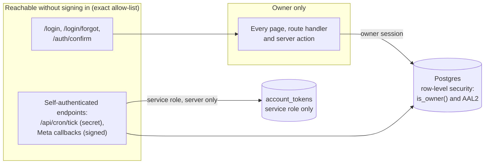

# Security and privacy

in2sight reads Instagram accounts and, optionally, writes to them (replies, hiding comments). It stores personal data: yours, and the names and comments of people who follow or comment. This document says what protects that data, what is *not* protected or verified yet, and how to report a problem.

> **Plainly:** in2sight is **not certified** to any standard (no SOC 2, ISO 27001, or similar), and **has not had an independent security audit**. What follows are the controls that exist in the code, how they are tested, and the known limits. It is a description, not a guarantee, and not legal advice.

**Contents:** [Reporting a vulnerability](#reporting-a-vulnerability) · [Security model](#security-model) · [Controls](#controls) · [How it is verified](#how-it-is-verified) · [Privacy and personal data](#privacy-and-personal-data) · [Platform and legal alignment](#platform-and-legal-alignment) · [Known limits](#known-limits) · [Hardening checklist for people who host it](#hardening-checklist-for-people-who-host-it)

---

## Reporting a vulnerability

**Please do not open a public issue for a security problem.** Use GitHub's private route: on the repository page open the **Security** tab and choose **Report a vulnerability**. Include what you found, the steps to reproduce, and the impact. Never include real tokens, keys, or other people's data in a report.

You can expect an acknowledgement and an honest assessment. This is a small, owner-run project, so there is no bug bounty and no guaranteed response time. Good-faith research that avoids other people's data is welcome.

Only the latest commit on `main` is supported.

---

## Security model

**Design assumption:** one owner per deployment. You host your own copy; there is exactly one human login, and every table is closed to everyone else.

Three layers must all agree before data is returned: the **proxy** (route policy), the **page or action** (`requireOwner()` / `assertOwner()`), and the **database** (row-level security). A mistake in one layer does not expose data by itself.

---

## Controls

### Identity and access
| Control | Detail |
|---|---|
| Single owner | The first sign-in claims ownership; sign-ups are disabled; every later user is refused and signed out. |
| Two-factor (TOTP) | Once a factor is enrolled, the **database itself** treats a password-only (AAL1) session as not-the-owner: `is_owner()`, used by every policy, requires AAL2. Calling the API directly with only a password returns nothing. |
| Route policy | A fixed allow-list of public paths (`lib/auth/route-policy.ts`). Everything else redirects to sign-in or to the 2FA step. |
| Defence in depth | Every data page, route handler and server action calls `requireOwner()` / `assertOwner()` itself, not only the proxy. A guard test checks this. |
| Password rules | 12+ characters, at most 72 bytes, at least 5 distinct characters, not derived from the email name. |
| Change password | Re-checks the current password on a separate memory-only client, then signs out every other session. |
| Reset password | Emailed link → confirmation page that requires a click (POST, so link scanners cannot consume it) → the 2FA code → new password within 15 minutes → all sessions signed out. The reset answer never reveals whether an account exists. |
| Attempt limits | Wrong-password attempts on the password forms are rate-limited per browser; Supabase Auth adds its own limits. |

### Secrets and tokens
| Control | Detail |
|---|---|
| Instagram tokens | Stored in `account_tokens`, readable **only** by the server's service role (no policy for the owner session). 60-day tokens, refreshed automatically before expiry. |
| Service-role key | Server-only. Used by sync, token storage and the delete action. The export and read paths use the owner session so they cannot reach tokens by privilege. |
| No secrets in the browser | Only the Supabase URL and publishable key are `NEXT_PUBLIC_`. Tests check that secret values never appear in rendered pages, route responses or error output. |
| No secret logging | Tokens, keys and request secrets are never logged or returned; error messages are fixed keys, not raw provider text. Guard tests ban logging statements in the sensitive modules. |
| Environment file | `.env*` is git-ignored; `npm run check:env` validates names and formats and never prints a value. |

### Endpoints that authenticate themselves
| Endpoint | Protection |
|---|---|
| `/api/cron/tick` | `Authorization: Bearer <CRON_SECRET>`, constant-time comparison, fails closed if the secret is unset. Answers `202` at once and runs the work under a time budget with a per-account lease so overlapping calls cannot double-run. |
| `/api/instagram/connect` and `/callback` | OAuth `state` is random, stored in a short-lived cookie (10 minutes), and compared in constant time; a mismatch or an expired state is refused. |
| `/api/instagram/deauthorize` and `/delete` | Meta's `signed_request`, verified with an HMAC of the app secret. The reply never says whether a user exists. |

### Data protection
| Control | Detail |
|---|---|
| Row-level security | On **every** table. Owner-authored tables use `is_owner()`; account data cascades from `accounts`. New migrations must keep this; a security advisor run follows every policy change. |
| Database functions | `security invoker` by default. The few `security definer` functions (the owner check and claim, and storage usage) exist only because they must read tables the owner session cannot (`auth.mfa_factors`, storage). Delete-all is executable by the service role only. |
| Cover images | In a **private** storage bucket, served only through an owner-checked route. Never public URLs, never signed links. |
| Data export | One streamed JSON file per table through the owner session. `account_tokens` and push subscriptions are excluded; other people's data only when you tick a box. Refuses cross-site navigations. |
| Delete all data | Needs your password (re-checked on a memory-only client) **and** a typed confirmation, then a single database transaction plus removal of cover images. Safe to run again. Your login, 2FA and settings are kept. |
| Framing | Every route sends `Content-Security-Policy: frame-ancestors 'self'`, so no other site can embed the app (clickjacking). |

### Writes to Instagram (comment moderation)
Reply, hide, unhide and delete each require a confirmation (delete needs a typed word), are recorded in an append-only moderation log (IDs and result keys, never text or names) and are reversible where Instagram allows it. Banned-word and spam rules show a live preview. **Auto-hide is off by default** and has a pause state if Instagram rejects writes.

---

## How it is verified

- **Automated tests:** about 3,100 tests in 309 files (`npm run check`: lint, typecheck, tests, production build). Analysis logic is pure and unit-tested; sync and API code use mocked responses.
- **Guard tests** that fail the build when a rule is broken, for example: no logging in auth, data and export files; the service role used only where intended; delete reachable only through its server action; no write method in the export; public paths exactly the allow-list; no admin-client import in modules that must not have one; secret values absent from rendered pages and responses.
- **Reviews:** each security-sensitive plan (sign-in, password, data and privacy) received a written, AI-assisted security review; every Critical and Important finding was fixed or documented. **No independent human audit has been done.**
- **Runbooks:** each feature has a live-verification runbook of exact checks ([`docs/RUNBOOK_SECURITY.md`](docs/RUNBOOK_SECURITY.md), [`RUNBOOK_DATA.md`](docs/RUNBOOK_DATA.md), [`RUNBOOK_AUTH.md`](docs/RUNBOOK_AUTH.md) and others). **Many of these live walkthroughs have not been completed yet**; the project status table in the README says which.

---

## Privacy and personal data

**What is stored (in your own Supabase project):**

| Data | Whose | Notes |
|---|---|---|
| Account insights, post and Story metrics, audience demographics (aggregates), covers | yours | the product's purpose |
| Instagram access tokens | yours | server-only table |
| Your email, preferences, push-subscription endpoints | yours | needed to sign in and notify you |
| Commenter usernames and comment text | **third parties** | read from your own posts; owner-only; cascade-deleted with the account; **never logged, never exported unless you tick the box** |
| Follower / following names | **third parties** | only if you upload your own Instagram export; parsed on your device; same handling |

**Principles in the design**
- **Self-hosted, your database.** There is no central server run by the project. Nobody but you and your own hosting providers (Vercel, Supabase) process the data.
- **Minimisation.** Only data the Instagram API returns for your accounts under the permissions you granted. No scraping, no crawling of followers.
- **Access control.** Only the owner, with 2FA, can read anything.
- **Portability and erasure.** Export every table, or delete everything, from Settings → Data and privacy. You can also remove in2sight at any time in Instagram under Website permissions → Apps and websites.
- **No third-party data in analytics views.** Aggregated analysis uses counts. Third-party names and comment text are shown only in the owner's own comment and follower views.
- **Planned AI features** will keep these rules: opt-in per account, your own model key or self-hosted agent, and no third-party personal data in prompts by default.

---

## Platform and legal alignment

This is **alignment by design, not certification**. If you host it, **you** are responsible for your own compliance.

| Topic | What the project does | What you still own |
|---|---|---|
| **Meta Platform Terms** | Uses the official *Instagram API with Instagram Login*; asks only for the permissions it needs; verifies Meta's signed deauthorize and deletion callbacks; stores tokens server-side. On a deletion request the account is **flagged for reconnect and its data is not erased automatically**: you delete it in the app. | Keep your Meta app in line with Meta's current terms; this project does not pass or replace any Meta review. |
| **GDPR / UK GDPR / similar** | Self-hosting makes **you** the data controller. The tool supplies access control, export, erasure (delete all), minimisation and no third-party sharing beyond your own processors. | A lawful basis and a privacy notice for processing commenters' and followers' data; data-processing terms with Supabase and Vercel; choosing your database region; responding to requests from the people in your data. |
| **Instagram's own terms** | No scraping, no automation of follows or likes, no password collection. Writes are limited to moderating comments on your own posts, with confirmation. | Using the moderation features within Instagram's rules. |
| **Certifications** | None (no SOC 2, no ISO 27001, no pen-test report). | If you need one, treat this project as one component and do your own assessment. |

---

## Known limits

Documented openly so you can decide what to rely on.

1. **No independent audit.** Reviews so far were AI-assisted.
2. **Live verification is incomplete.** Several features, including the password-reset flow and writes to Instagram, are code-complete and tested but not yet walked through against live services.
3. **Recovery link without 2FA.** If two-factor is **not** enrolled, an attacker who controls your inbox can reset your password. Enrol 2FA **before** enabling the reset-email template.
4. **Some password rules are app-level.** The "current password" check and the "2FA code before a new password" rule are enforced by this app's server actions. A signed-in session token can call Supabase Auth directly, so these are not a Supabase-side boundary. Your **data stays protected by the database policies** (AAL2) regardless. Two live checks (RUNBOOK_SECURITY L10 and L11) must pass before you enable the reset template.
5. **Signed-out devices stay valid for up to an hour.** "Sign out other devices", a password change or a reset revoke sessions, but an already-issued access token works until it expires (Supabase default: 1 hour). There is no list of sessions.
6. **No recovery codes.** Losing your authenticator means removing the factor in the Supabase dashboard.
7. **Content Security Policy is minimal.** Only `frame-ancestors 'self'` is set; there is no full script-source policy yet.
8. **Third-party data can be on screen.** Commenter names and text appear in the owner's comment views and in an export if you opt in. Treat screenshots and exports accordingly.
9. **Third-party services.** Your data passes through your Vercel and Supabase accounts and Meta's API. Their security is theirs.

---

## Hardening checklist for people who host it

- [ ] **Sign-ups off** in Supabase *before* your first sign-in (the first sign-in becomes the owner).
- [ ] **Enrol two-factor** in Settings → Security straight away.
- [ ] Use a **strong, unique password** from a password manager; keep the database password there too.
- [ ] Keep the Meta app in **Development mode**; add only your own accounts as testers.
- [ ] Put every variable in Vercel's environment settings; **never commit `.env*`**. Run `npm run check:env` after changes.
- [ ] Generate `CRON_SECRET` randomly (32 bytes) and keep it out of chats and screenshots.
- [ ] **Rotate** the Supabase secret key and the Meta app secret if either ever leaks, then update Vercel and redeploy.
- [ ] Do **not** enable the password-reset email template until 2FA is on and RUNBOOK_SECURITY checks L10 and L11 pass.
- [ ] Keep **auto-hide off** until the moderation probes pass on a throwaway comment.
- [ ] Production domain **not** behind Vercel Deployment Protection (the scheduler must reach it), but no other path left open: do not add public routes.
- [ ] Apply database migrations **before** deploying code that needs them; run the Supabase **Security advisor** after policy changes.
- [ ] Keep dependencies current (`npm audit`, then `npm run check`).
- [ ] Export your data regularly and keep the files private; delete exports that contain other people's names when done.
