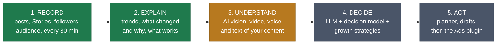
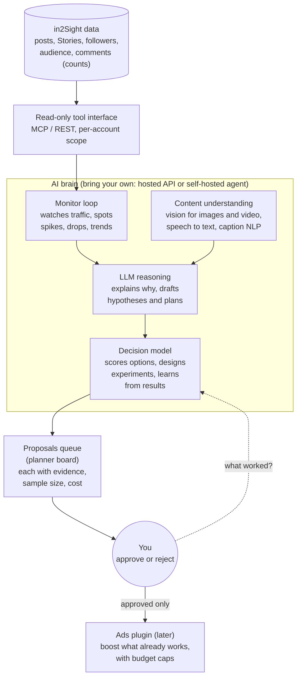

# The AI brain (vision, planned)

> **Honest status: none of this is built yet.** It is the direction in2Sight is heading. The data foundation it needs (continuous recording, per-post history, structured analysis) already works. This document is a vision and a set of constraints, not a specification; any build starts with a design pass and a [SPEC](SPEC.md) update.

## The goal

> **Give every creator and small brand the analyst, the strategist and the media buyer they cannot afford: an always-on AI that watches the traffic of your IP, understands what your content actually contains, and tells you (and, with your approval, does) what grows your audience. You keep the data and the final say.**

"Your IP" means your creator brand, channel, character or catalogue: the thing you are building an audience around.

Today's tools show you charts and leave the thinking to you. A number like "reach fell 28%" starts a question, it does not answer it. The answer sits in the content itself: the hook in the first second of a Reel, the face or product in the cover, what you said, the caption, the hour you posted, who is watching. A system that can *see, hear and read* your posts, remember what worked, and test new ideas can answer that question every day, which no person with a spreadsheet will.

## Five stages

Green = built (stage 2 is rule-based today). Amber = designed next. Grey = planned.

## Principles that do not change as the AI grows

- **You own the data.** It lives in your own database, on your own deployment. Self-hosted first.
- **Human in the loop.** The AI proposes; you approve. Nothing is posted, replied or spent without a click. Every action is logged and reversible where Instagram allows it.
- **Show the evidence.** Every claim states its sample size and confidence. "Not enough data" is an answer.
- **Bring your own brain.** Use a hosted model through your own API key (Claude, Codex and others) or a self-hosted agent runtime you control. No lock-in.
- **Private by default.** Your own content only. Other people's data (commenter names, follower lists) is never sent to a model unless you opt in.
- **Open source (MIT).** Auditable by the people whose accounts it touches.

## Target architecture

The brain is a layer **on top of** the data in2Sight already collects. It never touches Instagram directly: it reads through a narrow, read-only tool interface and writes only *proposals* that wait for your approval.

## What it should be able to do

- **Monitor** your traffic around the clock and tell you only what matters (a breakout post, a slow decline, a format that stopped working), not fifty pings.
- **Understand content** the way a viewer does: describe what is on screen, what is said, what the hook is, and link those features to the numbers. (A made-up example of the kind of finding: "Reels that open on a face keep more viewers".)
- **Recommend and plan**: what to post next, when, in which format and style, why, and how confident it is.
- **Learn from experiments**: propose a test, measure it against your own history, keep what works.
- **Boost with ads (later)**: put budget behind posts that already work, with caps you set. Ads use Meta's separate marketing permissions and review, so this comes last.

## How you would plug a brain in

1. **Hosted model, your key:** Claude, Codex or another LLM API, called from your own deployment with your own key and a spending cap.
2. **Self-hosted agent:** an agent framework you run yourself, talking to in2Sight through the same read-only tool interface, so your data never leaves your machines.

## Guardrails from the start

Opt-in per account, human approval for anything outward-facing, a hard budget and rate cap, a full audit log, a kill switch, and no third-party personal data in prompts by default.

## Order of work

The weekly planning tools (insights feed, goals and digest, smart alerts, planner board) come first: they produce the structured findings and the proposals queue the brain will use. See the roadmap in the [README](../README.md#-roadmap) and the plans in [`docs/superpowers/plans/`](superpowers/plans/). The roadmap decisions around AI (a paid model, a new secret, data sent to a third party) need the owner's explicit approval before any code is written.
